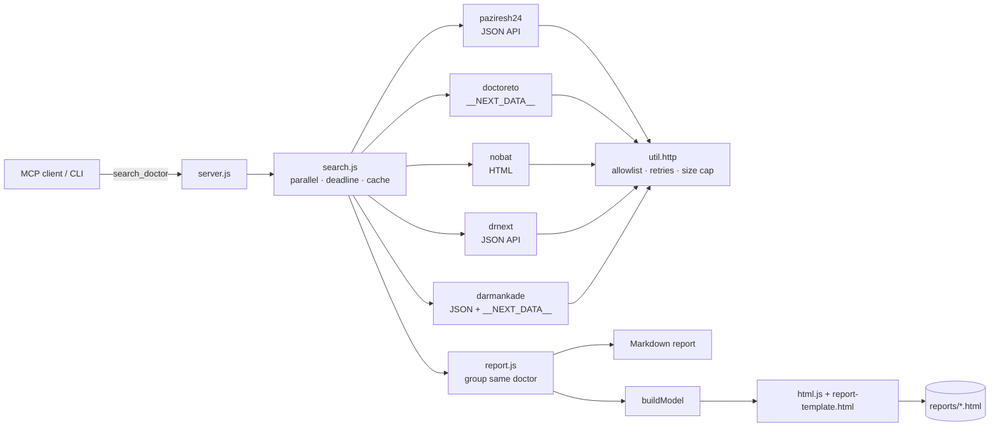

# iran-doctor-mcp

[](https://m8ven.ai/mcp/sinamohammadi-iran-doctor-mcp-4gwmhu?s=readme)
**Find a doctor by name across Iran's online booking sites: first free appointment, visit price and a booking link, in one answer.**

An [MCP](https://modelcontextprotocol.io) server (for Claude and other MCP clients) plus a command-line tool. It searches
five booking platforms in parallel, merges the profiles that belong to the same person, and produces:

- a **Persian report** for the chat (summary → one block per doctor → best options → next steps), and
- an **interactive HTML page** with filters, sorting and booking buttons that you can open in any browser.

> **فارسی:** نام پزشک (و در صورت امکان شهر) را بدهید؛ این ابزار در پذیرش۲۴، دکترتو، نوبت دات آی آر، دکترنکست و درمانکده
> جستجو می‌کند و برای هر پزشک زودترین نوبت خالی، هزینه ویزیت، تلفن مطب و لینک رزرو را نشان می‌دهد. پروفایل‌های یک پزشک
> در سایت‌های مختلف یکی می‌شوند و نتیجه یک صفحه HTML تعاملی هم دارد.

|           |                                                                     |
| --------- | ------------------------------------------------------------------- |
| Version   | 1.1.0 ([CHANGELOG](CHANGELOG.md))                                   |
| Runtime   | Node.js ≥ 22, two dependencies (`@modelcontextprotocol/sdk`, `zod`) |
| Transport | MCP over stdio                                                      |
| Tools     | `search_doctor`, `get_doctor_details`, `list_platforms`             |
| Tests     | `npm test` (offline, ~1 s) · `npm run test:live` (real sites)       |

---

## Contents

- [Quick start](#quick-start)
- [Connect to an MCP client](#connect-to-an-mcp-client)
- [Tools](#tools)
- [The report](#the-report)
- [HTML report and CLI](#html-report-and-cli)
- [Configuration](#configuration)
- [How it works](#how-it-works)
- [Supported platforms](#supported-platforms)
- [Security and privacy](#security-and-privacy)
- [Development](#development)
- [Adding a platform](#adding-a-platform)
- [Troubleshooting](#troubleshooting)
- [Limitations](#limitations)

---

## Quick start

```bash
npm install
npm test                                   # offline unit tests
npm run report -- "مریم احمدی" تهران        # search and open the HTML report in your browser
npm start                                  # run the MCP server on stdio (normally your MCP client starts it)
```

## Connect to an MCP client

### Claude Code

This folder already contains `.mcp.json`, so Claude Code picks the server up when started here. To use it in every project:

```bash
claude mcp add iran-doctor -s user -- node /absolute/path/to/iran-doctor-mcp/src/index.js
```

After changing the code, reconnect with `/mcp`.

### Claude Desktop and other clients

Add the server to the client's MCP configuration (for Claude Desktop: `claude_desktop_config.json`):

```json
{
  "mcpServers": {
    "iran-doctor": {
      "command": "node",
      "args": ["/absolute/path/to/iran-doctor-mcp/src/index.js"],
      "env": {
        "DOCTOR_MCP_REPORT_DIR": "/absolute/path/for/reports"
      }
    }
  }
}
```

If the package is installed globally (`npm install -g .`), `"command": "iran-doctor-mcp"` with no `args` also works.

### Try it with the MCP Inspector

```bash
npm run inspect
```

Then just ask, e.g. _«برای دکتر مریم احمدی در تهران زودترین نوبت را پیدا کن»_.

---

## Tools

### `search_doctor`

Searches all (or selected) platforms in parallel and returns the Persian report. Unless disabled, it also saves the HTML
page and returns it as a second content item (`resource_link`, `file://…`), with the path also written at the top of the report.

| Argument           | Type                                | Default                | Description                                                                                               |
| ------------------ | ----------------------------------- | ---------------------- | --------------------------------------------------------------------------------------------------------- |
| `name`             | string, 2–100 chars                 | — (required)           | Doctor's name in Persian. Last name alone works. Titles («دکتر») and Arabic letters (ي/ك) are normalised. |
| `city`             | string, ≤ 50 chars                  | —                      | Persian city name. Each platform is searched **inside** that city, so local doctors are not crowded out.  |
| `platforms`        | array                               | all                    | Subset of `paziresh24`, `doctoreto`, `nobat`, `drnext`, `darmankade`.                                     |
| `max_per_platform` | 1–10                                | 5                      | How many matching doctors to open per platform.                                                           |
| `visit_type`       | `all` \| `in_person` \| `online`    | `all`                  | Filter visit types in the report.                                                                         |
| `sort`             | `soonest` \| `cheapest` \| `rating` | `soonest`              | Order of doctors and options.                                                                             |
| `include_json`     | boolean                             | `false`                | Append the raw structured results as JSON.                                                                |
| `html`             | boolean                             | `DOCTOR_MCP_HTML` (on) | Save the interactive HTML page.                                                                           |

`isError` is set only when **every** platform failed. A single failing site is reported in the status line and the other results are still returned.

### `get_doctor_details`

Every visit type with price, first free time, clinic address and phones for **one** profile (nobat.ir also lists the next open days).

| Argument   | Description                                                                                                                                                                                                                                                    |
| ---------- | -------------------------------------------------------------------------------------------------------------------------------------------------------------------------------------------------------------------------------------------------------------- |
| `platform` | One of the platform ids.                                                                                                                                                                                                                                       |
| `id`       | The id from `search_doctor` JSON, or that platform's profile URL: paziresh24 = slug (`دکتر-مریم-احمدی-5`), doctoreto = `slug/code` (`dr-mehran-ahmadi/GxbEdZ`), nobat = page slug (`35865`), drnext = id (`zvOqzwrOZ4BZ`), darmankade = numeric id (`423925`). |

### `list_platforms`

Supported platforms, what each provides, and the sites that were checked but excluded (and why). It needs no network access.

---

## The report

`search_doctor` returns Markdown in Persian, written for the patient:

1. **Summary**: how many _different_ doctors share the name (by field), how many have a free slot now, and the soonest in-person and online slot.
2. **One block per doctor**: rating, sites, insurance, and a table of options (site · visit type/clinic · first free time · price · booking link), followed by clinic phones. Options without a free slot come last. Doctors with no free slot at all are listed briefly at the end, with profile links and phones.
3. **Best options**: soonest/cheapest in-person and online. When one option wins both, it is shown once («زودترین و ارزان‌ترین نوبت حضوری»).
4. **Next steps**: pick the right doctor, where to book, the online fallback, try another site, phone the clinic, insurance and cancellation, emergency **115**.
5. **Sites checked**: one line. Failures are listed there and also flagged at the top.

Dates use the Jalali calendar with Persian digits and a relative hint (امروز · فردا · ۳ روز دیگر · حدود ۲ هفته دیگر).
Phone numbers and URLs keep Latin digits so they can be dialed and clicked. Prices are in Toman. Rial prices from
Paziresh24 and DrNext are converted.

<details>
<summary>Example (shortened)</summary>

```markdown
# نتیجه جستجوی پزشک: «مریم احمدی» در تهران

_زمان جستجو: چهارشنبه ۲۷ آبان، ساعت ۱۱:۰۶ به وقت تهران · ۵ از ۵ سایت نوبت‌دهی بررسی شد_

📄 **نسخه تعاملی (HTML) این گزارش:** `/…/reports/doctor-20261118-110600-مریم-احمدی-تهران.html`

## خلاصه

- با این نام **۷ پزشک مختلف** پیدا شد (کاردرمانی، زنان و زایمان، قلب و عروق، …).
- **۲** پزشک الان نوبت خالی اینترنتی دارند و **۵** پزشک ندارند.
- **زودترین نوبت حضوری:** چهارشنبه ۲۷ آبان، ساعت ۰۸:۱۰ (امروز) — دکتر مریم احمدی در پذیرش۲۴

## ۱) پزشکان و نوبت‌های خالی (مرتب‌سازی: زودترین نوبت)

### ۱. دکتر مریم احمدی — کارشناس ارشد کاردرمانی · تهران

- امتیاز: ⭐ ۵٫۰ از ۵ (۱۱ نظر، رضایت ۱۰۰٪) در پذیرش۲۴
- در ۲ سایت: پذیرش۲۴، دکترتو

| سایت    | نوع ویزیت / محل                | اولین نوبت خالی                          | هزینه                     | لینک      |
| ------- | ------------------------------ | ---------------------------------------- | ------------------------- | --------- |
| پذیرش۲۴ | حضوری — مطب مریم احمدی، قیطریه | **چهارشنبه ۲۷ آبان، ساعت ۰۸:۱۰ (امروز)** | ۵۰٬۰۰۰ تومان (هنگام رزرو) | [رزرو](…) |
| دکترتو  | مشاوره تلفنی                   | **چهارشنبه ۲۷ آبان، ساعت ۱۴:۰۰ (امروز)** | ۱۰۰٬۰۰۰ تومان             | [رزرو](…) |
```

</details>

### How "same doctor" is decided

Profiles are merged only when **name, city and medical field** all match:

- **Names** are normalised: titles (دکتر, پروفسور), «سید/سیده», Arabic letters, ZWNJ and spacing are ignored.
- **Fields** are canonicalised, so «کارشناسی ارشد کار درمانی» = «کارشناس ارشد کاردرمانی» and «فوق تخصص زنان و زایمان» = «متخصص زنان و زایمان». A cardiologist and a midwife with the same name stay separate.
- **Missing city or specialty:** a profile without one joins a group only if exactly one group matches.

This is a heuristic. Two different doctors with the same name, city and field would be merged. The report reminds the
patient to check the medical council number (شماره نظام پزشکی) before booking.

---

## HTML report and CLI

Every search writes one self-contained file, `doctor-<YYYYMMDD-HHMMSS>-<name>-<city>.html`, in `DOCTOR_MCP_REPORT_DIR` (default: the OS temp folder, see [Configuration](#configuration)). Its data is embedded
in the file, so there is no server or build step. It works offline, except for the web font, which falls back to Tahoma.

**What's on the page**

- **Summary tiles:** doctors found, how many have a free slot, and the soonest in-person and online slot. Clicking a tile jumps to that doctor.
- **Filters:**
  - text search across name, specialty, clinic and address
  - visit type (all / in-person / online)
  - "only free slots"
  - specialty chips and site chips (with counts)
  - sorting by soonest, cheapest or rating
- **Best-option cards:** these follow the active filters.
- **Doctor cards:** «رزرو نوبت» (book) buttons, relative-time pills, tap-to-call phones and profile links. Options without a free slot are folded away.
- **Opening it later:** relative times are computed when the page is opened. A banner warns when the data is more than 3 hours old.
- **Display:** light/dark mode (it follows the system and can be toggled), mobile layout, and print / save as PDF (folded options are expanded for printing).

**CLI**

```bash
npm run report -- "<doctor name>" [city] [options]
# or, after `npm install -g .`
iran-doctor-report "<doctor name>" [city] [options]
```

| Option            | Description                                              |
| ----------------- | -------------------------------------------------------- |
| `--max <n>`       | Doctors to open per site (1–10, default 5).              |
| `--platforms a,b` | Subset of platform ids.                                  |
| `--sort <s>`      | `soonest` \| `cheapest` \| `rating` (Markdown output).   |
| `--md`            | Also print the Persian Markdown report.                  |
| `--json`          | Print the raw results as JSON (no HTML unless `--html`). |
| `--html`          | Save HTML even with `--json`.                            |
| `--no-open`       | Save the page but don't open the browser.                |

Exit codes: `0` success · `1` every site failed · `2` bad arguments · `78` invalid configuration.

```bash
iran-doctor-report احمدی شیراز --platforms paziresh24,doctoreto --no-open
iran-doctor-report "مریم احمدی" تهران --json > result.json
```

---

## Configuration

All settings are optional environment variables. They are validated at startup. An invalid value stops the process with
a one-line message and exit code 78.

| Variable                          | Default                              | Description                                                                                                                                     |
| --------------------------------- | ------------------------------------ | ----------------------------------------------------------------------------------------------------------------------------------------------- |
| `DOCTOR_MCP_TIMEOUT_MS`           | `20000`                              | Timeout of one HTTP request (1000–120000).                                                                                                      |
| `DOCTOR_MCP_RETRIES`              | `2`                                  | Retries per request on network errors, timeouts, 429 and 5xx (0–5). Other 4xx responses are never retried.                                      |
| `DOCTOR_MCP_PLATFORM_DEADLINE_MS` | `45000`                              | Hard deadline for one platform's whole search. A slower site is reported as failed.                                                             |
| `DOCTOR_MCP_MAX_RESPONSE_BYTES`   | `8388608`                            | Max response body size (8 MB).                                                                                                                  |
| `DOCTOR_MCP_CACHE_TTL`            | `120`                                | Seconds to cache identical searches (per platform). `0` disables the cache.                                                                     |
| `DOCTOR_MCP_HTML`                 | `true`                               | Save an HTML page for every `search_doctor` call. The tool argument `html` overrides this.                                                      |
| `DOCTOR_MCP_REPORT_DIR`           | `<OS temp>/iran-doctor-mcp/reports/` | Where HTML reports are written. The default is always writable, also for global / `npx` installs; set this to keep reports somewhere permanent. |
| `DOCTOR_MCP_REPORT_KEEP`          | `200`                                | Keep at most this many reports; the oldest are deleted. `0` keeps all.                                                                          |
| `DOCTOR_MCP_LOG_LEVEL`            | `info` (CLI: `warn`)                 | `debug` \| `info` \| `warn` \| `error` \| `silent`.                                                                                             |

**Logging.** Logs are JSON lines on **stderr** (stdout is reserved for the MCP protocol), for example:

```json
{
  "t": "2026-11-18T09:13:23.449Z",
  "level": "info",
  "msg": "search done",
  "ms": 9696,
  "doctors": 10,
  "failed": []
}
```

Use `DOCTOR_MCP_LOG_LEVEL=debug` to see every HTTP request with its timing, size, attempt number and errors.

---

## How it works



```
src/
  index.js              stdio entry point: start server, graceful shutdown, crash logging
  server.js             MCP tools (schemas, annotations, output)
  search.js             platform registry, parallel search, per-site deadline, cache
  report.js             grouping, Markdown report, buildModel() for the HTML page
  html.js               render/save HTML (CSP hash, atomic write, pruning), open in browser
  report-template.html  the page: CSS + vanilla JS, data injected as JSON
  cli.js                terminal command
  config.js             environment configuration (validated)
  log.js                stderr JSON logger
  util.js               HTTP client, Persian text, Tehran time, Jalali calendar
  providers/            one module per booking site
test/
  unit/*.test.js        offline tests (node:test)
  helpers/              test env + synthetic fixtures (no real people)
  live.js               end-to-end test against the real sites over MCP stdio
```

---

## Supported platforms

| Platform                | Name search | City search             | First free time      | Price                                         | Source                 |
| ----------------------- | ----------- | ----------------------- | -------------------- | --------------------------------------------- | ---------------------- |
| پذیرش۲۴ paziresh24.com  | ✓           | ✓ `/search/{slug}`      | ✓ exact time         | ✓ Rial → Toman                                | JSON API               |
| دکترتو doctoreto.com    | ✓           | ✓ `citySlug=`           | ✓ exact time         | ✓ online visits (office visit paid at clinic) | `__NEXT_DATA__`        |
| نوبت nobat.ir           | ✓           | ✓ city in query         | ✓ day + clinic hours | ✗ booking is free, paid at clinic             | HTML                   |
| دکترنکست drnext.ir      | ✓           | filtered on office city | ✓ exact time         | ✓ Rial → Toman                                | JSON API               |
| درمانکده darmankade.com | ✓           | ✓ `city=`               | ✓ exact time         | ✓ Toman                                       | JSON + `__NEXT_DATA__` |

**Checked and not added**, because they don't offer the same "name → free time → price" search:

- DoctorYab
- Snapp Doctor
- Tebinja
- HiDoctor
- the insurance portals that need a login

`list_platforms` shows the reasons.

---

## Security and privacy

- **Network allowlist.** The HTTP client fetches only `paziresh24.com`, `doctoreto.com`, `nobat.ir`, `drnext.ir`,
  `darmankade.com` and their subdomains, and checks again after redirects. User-supplied ids and URLs can't make the
  server request other hosts, including internal addresses (no SSRF).
- **Bounded work.** Every request has a timeout, a retry limit and a response-size cap, and each platform has an overall deadline.
- **HTML page.** Data is embedded as escaped JSON (it can't close its `<script>` block). The page is rendered with
  escaping, and a Content-Security-Policy lets only the page's own script run, pinned by its SHA-256 hash. The page can't
  send anything anywhere (`default-src 'none'`, `form-action 'none'`, `no-referrer`). Links accept only `http(s)` URLs.
- **What is stored.** Nothing besides the HTML reports you ask for, in `DOCTOR_MCP_REPORT_DIR`, pruned automatically.
  Logs don't contain search terms. There are no accounts, no tokens and no telemetry.
- **Data source.** Only public profile pages and public endpoints of the booking sites are read, the same data a visitor
  sees. Results are cached briefly to avoid repeated requests. Please keep request volumes modest.

---

## Development

```bash
npm test             # offline unit tests (util, grouping/report, HTML safety, search resilience, MCP server)
npm run test:live    # real end-to-end run over MCP stdio:  node test/live.js "مریم احمدی" تهران
npm run check        # syntax check of every source file
npm run inspect      # MCP Inspector UI
```

**What the offline tests cover:**

- Jalali calendar round-trips for every day from 2015 to 2035, Persian digits, name and city normalisation.
- The URL allowlist.
- Doctor grouping and every report section.
- XSS attempts against the HTML page, the CSP hash, atomic save and pruning.
- Per-site deadlines, error mapping and the cache.
- The MCP tool list, input limits and the SSRF refusal.

**Releasing:**

1. Bump `version` in `package.json`. The server reads its version from there.
2. Add an entry to `CHANGELOG.md`.
3. Run `npm test && npm run test:live`.

---

## Adding a platform

Create `src/providers/<id>.js` exporting:

```js
export const info = {
  id: "<id>",
  name: "نام فارسی",
  site: "https://…",
  app: "…",
  notes: "…",
};

/** Doctors matching `name` (and `city`, if given), at most `limit`. */
export async function search(name, { city, limit }) {
  return [
    /* Doctor */
  ];
}

/** One profile by id or profile URL. */
export async function details(id) {
  return /* Doctor */;
}
```

```ts
type Doctor = {
  platform: string;
  platformName: string;
  id: string;
  name: string;
  specialty: string | null;
  city: string | null;
  rating: number | null;
  ratingCount: number | null;
  satisfaction: number | null; // satisfaction in %
  insurances: string[];
  profileUrl: string;
  notes: string[];
  services: Service[];
};
type Service = {
  type:
    | "in_person"
    | "online"
    | "online_phone"
    | "online_text"
    | "online_video"
    | "online_audio";
  label: string;
  priceToman: number | null;
  priceNote: string | null; // e.g. "حق ویزیت در مطب"
  firstFree: Date | null; // a real instant (Tehran time handled by util.parseTehranLocal)
  firstFreeIsDayOnly?: boolean;
  firstFreeLabel: string | null; // label explains why there is no slot, or clinic hours
  center: string | null;
  address: string | null;
  phones: string[];
  bookingUrl: string;
  openDays?: { date: Date; hours: string | null }[];
};
```

Then:

1. Register the module in `PROVIDERS` in `src/search.js`.
2. Add the site's domain to `ALLOWED_HOSTS` in `src/util.js`.
3. Add a colour token `--s-<id>` in `report-template.html` (light and dark) and the id to the `SITES` list there.
4. Make sure `search()` uses `util.http()` and `nameMatches()` / `cityMatches()`, and that it **throws** on real failures. `searchAll` turns a failure into a status entry, so other platforms aren't affected.

---

## Troubleshooting

| Symptom                                                       | What to do                                                                                                                                                                                                                                |
| ------------------------------------------------------------- | ----------------------------------------------------------------------------------------------------------------------------------------------------------------------------------------------------------------------------------------- |
| A site shows `✗ … پاسخ نداد (timeout / HTTP 403 / ENOTFOUND)` | It's temporary or the site blocks your network; the other sites still work. Run with `DOCTOR_MCP_LOG_LEVEL=debug` to see the request. If one site keeps failing with parse errors, its page layout probably changed: update its provider. |
| `configuration error: Invalid …` and exit 78                  | Fix that environment variable (see [Configuration](#configuration)).                                                                                                                                                                      |
| The client doesn't list the tools                             | Check that `node --version` is ≥ 22 and that the path in the client config is absolute, then reconnect (`/mcp` in Claude Code). Logs go to the client's MCP log (stderr).                                                                 |
| Times look shifted                                            | Times are computed in `Asia/Tehran` (UTC+03:30, no DST since 2022). The HTML page uses the browser's `Intl` time-zone data.                                                                                                               |
| Too many doctors with the same name                           | Pass `city`, or use the specialty chips on the HTML page.                                                                                                                                                                                 |
| HTML page has no font styling offline                         | It falls back to Tahoma/system fonts; everything else works offline.                                                                                                                                                                      |

---

## Limitations

- **Unofficial endpoints.** These are the sites' public web endpoints, not documented APIs. A site redesign can break
  its provider until it is updated. The other platforms keep working.
- **Live snapshots.** Prices and free slots are read at search time and can change before you book. On Paziresh24 an
  office-visit price is the amount paid at booking. On nobat.ir only the day and the clinic hours are known.
- **Same-doctor merging is a heuristic** (see [How "same doctor" is decided](#how-same-doctor-is-decided)).
- **Not medical advice.** This tool finds appointments; it doesn't recommend doctors. In an emergency call **115**.
